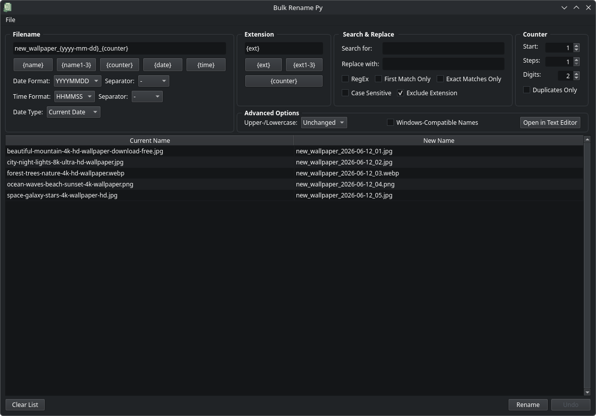

# Bulk Rename Py

Bulk Rename Py is a Python desktop application for renaming files in bulk.
Combine filename patterns, search and replace, counters, and date/time placeholders,
review the resulting names in a preview, and apply the changes together.
An undo function helps restore previous names during the current session.



## Features

- Independent editing of filenames and extensions
- Combinable placeholders, character ranges, counters, and date/time formats
- Search and replace with wildcards, regular expressions, and case options
- Duplicate detection, filename validation, and Windows-compatible names
- File and folder import, hidden-file options, and drag and drop
- Preview editing through an external text editor
- Rename and undo with recovery information after failures
- German and English interface

## How it works

Add files or folders and configure the naming options. The table shows current
filenames on the left and proposed names on the right. Review the preview and
resolve validation errors, then confirm the rename operation.

Use the external editor to adjust individual proposed names. Save the edited
list, return to the application, and confirm loading it into the preview.
The imported names go through the same validation as generated names.

Undo is available during the current session. Changing or clearing the file list
resets the undo history, as does closing the application.

## Technology

The application uses Python 3.14 or newer and Qt Widgets through PySide6 Essentials.
Requests and certifi support checking GitHub releases from the About dialog.
Dependencies are listed in [requirements.txt](requirements.txt).

The application has been tested on Linux (Arch Linux) and Windows.

## Getting started

Install Python 3.14 or newer, then clone the repository:

```bash
git clone https://github.com/codemorra/bulk-rename-py.git
cd bulk-rename-py
```

Run the application from this source checkout using the instructions for your
operating system.

### Linux

Create a virtual environment and install the dependencies:

```bash
python -m venv .venv
source .venv/bin/activate
python -m pip install -r requirements.txt
```

Start the application:

```bash
chmod +x start_linux.sh
./start_linux.sh
```

The launcher uses the repository's `.venv` interpreter. Later starts can use the
same launcher directly.

#### Optional: Add a start menu entry with icons

Run these commands from the repository root on a desktop supporting `.desktop`
files. Install the desktop entry:

```bash
install -Dm644 packaging/linux/bulk-rename-py.desktop ~/.local/share/applications/bulk-rename-py.desktop
```

Install the icons in the corresponding hicolor directories:

```bash
for s in 16 32 64 128 256 512; do
    install -Dm644 assets/icons/png/bulk-rename-py_${s}.png ~/.local/share/icons/hicolor/${s}x${s}/apps/bulk-rename-py.png
done
```

Open `~/.local/share/applications/bulk-rename-py.desktop` and set **Exec** and
**TryExec** to the absolute paths of your local installation. Replace
`<PATH_TO_REPOSITORY>` in this example:

```ini
Exec="<PATH_TO_REPOSITORY>/.venv/bin/python" "<PATH_TO_REPOSITORY>/src/main.py"
TryExec=<PATH_TO_REPOSITORY>/.venv/bin/python
```

Make the desktop file executable:

```bash
chmod +x ~/.local/share/applications/bulk-rename-py.desktop
```

The application should now appear in the start menu with its icon.

### Windows

In Command Prompt, create a virtual environment and install the dependencies:

```bat
python -m venv .venv
.venv\Scripts\activate.bat
python -m pip install -r requirements.txt
```

Start the application from the project directory:

```bat
start_windows.bat
```

The launcher uses the repository's `.venv` interpreter. You can also double-click
`start_windows.bat` in File Explorer.

#### Optional: Create a desktop shortcut

Right-click the desktop and choose **New → Shortcut**. Set the target to:

```text
"<PATH_TO_REPOSITORY>\.venv\Scripts\pythonw.exe" "<PATH_TO_REPOSITORY>\src\main.py"
```

Open the shortcut's **Properties → Change Icon** and select:

```text
<PATH_TO_REPOSITORY>\assets\icons\bulk-rename-py.ico
```

## Local builds

You can run the application from the source checkout as described above, or build
a standalone executable locally using [PyInstaller](https://pyinstaller.org/).
The executable includes Python and the application's runtime dependencies.

Builds support Linux x86-64 and Windows x86-64. Use a 64-bit Python 3.14 or newer
and the `.venv` prepared above. Build on the target operating system: Linux
builds on Linux, Windows builds on Windows.

### Linux build

From the repository root, install the separate build requirements and build either
or both formats:

```bash
source .venv/bin/activate
python -m pip install -r requirements-build.txt
python scripts/build.py onedir
python scripts/build.py onefile
```

The executables are located at `dist/onedir/bulk-rename-py/bulk-rename-py` and
`dist/onefile/bulk-rename-py`.

### Windows build

From the repository root in Command Prompt:

```bat
.venv\Scripts\activate.bat
python -m pip install -r requirements-build.txt
python scripts/build.py onedir
python scripts/build.py onefile
```

The executables are located at `dist\onedir\bulk-rename-py\bulk-rename-py.exe` and
`dist\onefile\bulk-rename-py.exe`.

Windows builds use the existing application icon and launch directly into the
graphical interface.

### Build output and compatibility

- `onedir` creates a folder containing the executable and its support files.
  Keep the entire `dist/onedir/bulk-rename-py/` folder together, including `_internal`.
- `onefile` creates a single executable that extracts its support files
  temporarily when launched (startup may take longer).

Both formats keep settings and logs in the user directories documented below.

The build script uses its current Python environment. Install the build
requirements before running it; these include the runtime requirements used for
running from source. Temporary build files, generated `.spec` files, and the
PyInstaller cache are kept under `build/`. Rebuilding the same format replaces
its previous output.

On Linux, the build system's glibc and native libraries affect compatibility.
The [PySide6 Essentials 6.11.1 x86-64 wheels](https://pypi.org/project/PySide6-Essentials/6.11.1/#files)
require glibc 2.34 or newer. To target glibc 2.34, build in a compatible environment
where Python and all native dependencies also support that version, then test on
the target systems. A build made on a newer system may require a newer glibc.
Use the oldest supported build environment for broader compatibility, as described
in the [PyInstaller Linux guidance](https://pyinstaller.org/en/stable/usage.html#making-gnu-linux-apps-forward-compatible).

## Naming options

### Placeholders

Use placeholders in filename and extension patterns:

| Placeholder | Meaning                                                        |
| ----------- | -------------------------------------------------------------- |
| `{name}`    | Current filename without the extension                         |
| `{name1-3}` | Characters 1 through 3 of the current filename                 |
| `{name4-*}` | Current filename from character 4 to the end                   |
| `{ext}`     | Current extension                                              |
| `{ext1-2}`  | Characters 1 through 2 of the extension                        |
| `{counter}` | Counter using the configured start, increment, and digit width |
| `{date}`    | Date using the configured source and format                    |
| `{time}`    | Time using the configured source and format                    |

Ranges use positions starting at 1. Both name and extension ranges support `*`
for the beginning or end, for example `{name*-5}` and `{ext1-*}`.

Custom date patterns include `{yyyy-mm-dd}`, `{dd.mm.yyyy}`, `{yyyy dd mm}`,
`{mm;dd;yyyy}`, `{yyyy_mm}`, `{mm:yyyy}`, and `{yyyy}`. Time examples include
`{hh-mm-ss}`, `{hh.mm}`, and `{hhmmss}`. Supported separators are `-`, `_`, `.`,
`:`, `;`, a space, or none. Windows-compatible naming replaces invalid characters
such as `:` with `_`.

### Search and replace

Wildcard search supports these patterns:

| Pattern | Meaning                          |
| ------- | -------------------------------- |
| `*`     | Match as little text as possible |
| `**`    | Match as much text as possible   |
| `?`     | Match one character              |

Options include regular expressions, case sensitivity, whole-word matching,
replacing only the first match, and excluding extensions.

### Counters and case

Configure the counter's start value, increment, and digit width. Duplicate-only
numbering applies counters to names that would otherwise collide.

Case transformations apply to filenames and offer lowercase, uppercase, heading
case, and mocking case. Extensions have their own naming pattern.

## Behavior and local settings

Windows-compatible naming is optional on Linux and always enabled on Windows.
It replaces invalid characters and handles reserved names such as `CON`, `PRN`,
and `NUL`. Validation checks filename length in Linux UTF-8 bytes and
Windows UTF-16 code units.

On Windows, add `.lnk` directory shortcuts through **Add folder**; **Add file(s)**
opens their target directory instead.

Settings are stored in `config.ini` under these locations:

| Platform | Location                                                                  |
| -------- | ------------------------------------------------------------------------- |
| Linux    | `$XDG_CONFIG_HOME/BulkRenamePy/`, defaulting to `~/.config/BulkRenamePy/` |
| Windows  | `%APPDATA%\BulkRenamePy\`                                                 |

Keep a backup of important files before renaming. File permissions, filesystem
changes, and other applications can affect a rename or its recovery. The developer
assumes no responsibility for data loss.

## Application logs

The application writes local logs to help diagnose errors. The log file is named
`bulk-rename-py.log` and is stored in these locations:

| Platform | Location                                                                                |
| -------- | --------------------------------------------------------------------------------------- |
| Linux    | `$XDG_STATE_HOME/BulkRenamePy/logs/`, defaulting to `~/.local/state/BulkRenamePy/logs/` |
| Windows  | `%LOCALAPPDATA%\BulkRenamePy\logs\`                                                     |

Logs rotate automatically at 1 MiB per file, keeping three older files as backups.
If the log file cannot be created, logging falls back to the console and the
application continues to start.

## Updates

Check for new GitHub releases in the About dialog. To update a Git checkout,
close the application and run `git pull` from the project directory. Then update
the dependencies using the project interpreter.

Linux:

```bash
source .venv/bin/activate
python -m pip install -r requirements.txt --upgrade
```

Windows Command Prompt:

```bat
.venv\Scripts\activate.bat
python -m pip install -r requirements.txt --upgrade
```

To update a locally built executable, repeat the dependency installation and build
steps in [Local builds](#local-builds) after updating the checkout. Then use the
newly generated executable.

## Maintenance and quality checks

The project has undergone an AI-assisted review and refactoring focused on:

- Safer rename and undo operations, including conflict handling and recovery paths
- Consistent validation for generated and externally edited names
- Reuse of prepared search patterns, timestamps, and file metadata during previews
- More reliable table actions, import cancellation, and external editor handling
- Atomic configuration writes, simpler modules, and fewer runtime dependencies
- Regression tests for file operations, naming rules, settings, and GUI workflows

With the virtual environment active, install the development dependencies and run
checks from the repository root:

```bash
python -m pip install -r tests/requirements.txt
python -m pytest
python -m ruff check src tests
python -m ruff check scripts/build.py
```

See [the test documentation](tests/README.md) for individual checks and coverage.
After changing the application icon, regenerate the compiled Qt resource on Linux:

```bash
./scripts/rebuild_icons.sh
```

## License

This project is licensed under the MIT License. See the [LICENSE](LICENSE) file for details.

The [dependency overview](THIRD_PARTY_LICENSES.txt) lists third-party licenses
and links to their upstream texts.
